# Anti-Proxy Attendance System (Cloud-Based)

A serverless attendance system that stops proxy attendance. Faculty start a session and display a **live QR code that changes every 30 seconds**. Students scan it from their own phones, so a photo or screenshot of the QR becomes useless almost immediately.

**Live demo:** https://amrith5307.github.io/Anti-Proxy-Attendance-System-Cloud-Based-Project/

---

## Features

- **Role-based login** with Amazon Cognito (Faculty and Student groups)
- **Rotating QR code** (refreshes every 30 seconds) so shared photos expire
- **Duplicate protection:** a student cannot be marked present twice in one session
- **Session control:** attendance is rejected once a session is closed
- **Auto-close:** an EventBridge schedule closes expired sessions every 5 minutes
- **Reports:** faculty see all their sessions and who attended; students see their own history
- **Email report** sent through Amazon SNS when a session closes
- **Faculty-only actions** enforced on the backend, not just in the UI

---

## Architecture

```mermaid
flowchart LR
    F[Faculty browser] -->|HTTPS + ID token| APIGW[API Gateway]
    S[Student phone] -->|HTTPS + ID token| APIGW
    F -. login .-> COG[Amazon Cognito]
    S -. login .-> COG
    APIGW -->|Cognito authorizer| COG
    APIGW --> L1[start_session]
    APIGW --> L2[generate_token]
    APIGW --> L3[mark_attendance]
    APIGW --> L4[close_session]
    APIGW --> L5[report]
    L1 --> D1[(DynamoDB: attendance-sessions)]
    L2 --> D1
    L3 --> D1
    L3 --> D2[(DynamoDB: attendance-records)]
    L4 --> D1
    L4 --> D2
    L5 --> D1
    L5 --> D2
    L4 --> SNS[Amazon SNS report email]
    EB[EventBridge every 5 min] --> L6[auto_close]
    L6 --> D1
    L6 --> SNS
```



| Service | Purpose |
|---|---|
| Amazon Cognito | User sign-in, Faculty and Student groups |
| API Gateway | REST API with a Cognito authorizer |
| AWS Lambda (Python 3.12) | Business logic |
| DynamoDB | Sessions table and attendance records table |
| Amazon SNS | Attendance report emails |
| EventBridge | Scheduled auto-close of expired sessions |
| GitHub Pages | Hosts the static frontend over HTTPS |

---

## How it works

1. Faculty log in and start a session (subject and duration).
2. The faculty page requests a short-lived signed token every 30 seconds and shows it as a QR code.
3. A student logs in on their phone and scans the QR with the in-browser camera scanner.
4. The backend checks the token, the session status and whether the student is already marked, then records attendance.
5. Faculty close the session (or it auto-closes) and a report is sent by email.

### Anti-proxy checks

| Attempt | Result |
|---|---|
| Scan the same QR twice | Rejected: attendance already marked |
| Scan a photo of an old QR | Rejected: token expired |
| Scan after the session is closed | Rejected: session not active |
| Student calls a faculty-only action | Rejected: faculty only |

---

## API endpoints

| Method | Path | Who | Description |
|---|---|---|---|
| POST | `/sessions` | Faculty | Start a session |
| GET | `/sessions/{session_id}/token` | Faculty | Get the current rotating token |
| POST | `/sessions/{session_id}/close` | Faculty | Close a session |
| POST | `/attendance` | Student | Mark attendance with a scanned token |
| GET | `/reports` | Both | Faculty: their sessions. Student: their attendance |
| GET | `/reports/{session_id}` | Faculty | Who attended a session |

---

## Project structure

```
.
├── template.yaml      # AWS SAM template (all infrastructure)
├── src/               # Lambda functions (Python)
├── frontend/          # Static frontend (login, faculty, student)
└── docs/              # Copy of frontend, published by GitHub Pages
```

---

## Deployment

**Prerequisites:** AWS account, AWS CLI configured, AWS SAM CLI, Python 3.12.

```bash
sam build
sam deploy --guided      # first time; later just: sam deploy
```

After deployment, note the stack outputs (`ApiUrl`, `UserPoolId`, `UserPoolClientId`) and put the API URL and Cognito values into the frontend files.

### Create test users

```bash
# Faculty
aws cognito-idp admin-create-user --user-pool-id <POOL_ID> --username faculty@example.com \
  --user-attributes Name=email,Value=faculty@example.com Name=email_verified,Value=true Name=name,Value=FacultyTest \
  --message-action SUPPRESS --region <REGION>
aws cognito-idp admin-set-user-password --user-pool-id <POOL_ID> --username faculty@example.com \
  --password "<PASSWORD>" --permanent --region <REGION>
aws cognito-idp admin-add-user-to-group --user-pool-id <POOL_ID> --username faculty@example.com \
  --group-name Faculty --region <REGION>

# Student: repeat with a student email and --group-name Student
```

### Run the frontend locally

```bash
cd frontend
python -m http.server 8000
```

Open http://localhost:8000/. Phone camera access needs HTTPS, so use the GitHub Pages link when testing on a phone.

### Publish with GitHub Pages

Copy `frontend` to `docs`, push, then in the repo go to **Settings > Pages**, choose branch `main` and folder `/docs`.

---

## Configuration notes

- Change the `TokenSecret` parameter in `template.yaml` before real use.
- To receive report emails, subscribe an email address to the `attendance-reports` SNS topic and confirm the subscription.
- CORS is currently open (`*`) for development. Restrict it to your site's origin for production.

---

## Known limitations and future work

- A student could still share the live QR over a video call. Possible fixes: location (geofence) check, device binding, or Wi-Fi/network checks.
- Reports use DynamoDB scans, which is fine for a class project but should become queries with indexes at scale.
- Faculty cannot yet export attendance as CSV.
- Add a "Close All Active" button and per-student attendance percentage.

---

## Tech stack

Python 3.12, AWS SAM, Cognito, API Gateway, Lambda, DynamoDB, SNS, EventBridge, HTML/CSS/JavaScript, qrcode.js, jsQR.
